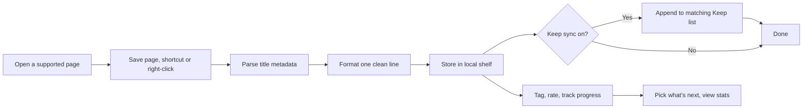

# KeepShelf

<p align="center">
  
</p>

<p align="center">
  <strong>Save movies, series, anime, books and links to a personal shelf in one click.<br>
  Rate them, tag them, track your progress, and optionally mirror everything to Google Keep.</strong>
</p>

<p align="center">
  <a href="manifest.json"></a>
  <a href="manifest.json"></a>
  <a href="LICENSE"></a>
  <a href="package.json"></a>
  
  
</p>

<p align="center">
  <a href="../../releases/latest"></a>
</p>

<p align="center">
  <a href="#quick-start">Quick start</a> ·
  <a href="#features">Features</a> ·
  <a href="#supported-sources">Sources</a> ·
  <a href="#organise-and-track-your-shelf">Organise</a> ·
  <a href="#google-keep-sync">Keep sync</a> ·
  <a href="#installation">Install</a> ·
  <a href="#faq">FAQ</a>
</p>

---

## Screenshots

<p align="center">
  
  
  
  
</p>

---

## At a glance

| | |
|---|---|
| **What it does** | Reads title metadata from supported pages and saves a clean, formatted entry to your local shelf with one click |
| **Beyond saving** | Tags, custom lists, personal ratings and reviews, watch/read progress, a random "what next" picker, and a stats dashboard |
| **Also works as** | A lightweight bookmark manager for tabs, links and notes |
| **Where data lives** | Locally in Chrome storage on your device. Optional sync to your own Google Keep notes, and optional TMDB lookups with your own free token |
| **Who it is for** | Anyone keeping a watchlist, reading list, anime list or link collection without copy-pasting or tab-hoarding |
| **Setup time** | About 2 minutes to load the extension, about 5 more to link Keep notes if you want sync |
| **Cost** | Free and open source. No accounts, no API keys, no cloud backend |

---

## Table of contents

- [Why KeepShelf exists](#why-keepshelf-exists)
- [Quick start](#quick-start)
- [How it works](#how-it-works)
- [Features](#features)
- [Organise and track your shelf](#organise-and-track-your-shelf)
- [TMDB info](#tmdb-info)
- [Supported sources](#supported-sources)
- [Tabs, links and notes](#tabs-links-and-notes)
- [Output format](#output-format)
- [Installation](#installation)
- [Usage guide](#usage-guide)
- [Google Keep sync](#google-keep-sync)
- [Backup and import](#backup-and-import)
- [Privacy and data](#privacy-and-data)
- [Permissions explained](#permissions-explained)
- [Development](#development)
- [FAQ](#faq)
- [Troubleshooting](#troubleshooting)
- [Roadmap](#roadmap)
- [Contributing](#contributing)
- [License](#license)

---

## Why KeepShelf exists

Someone sends you ten movie and book recommendations. The usual workflow:

1. Google the title
2. Copy the name, year and rating by hand
3. Switch to Google Keep or a notes app
4. Paste one formatted line
5. Repeat nine more times

That takes minutes per title. KeepShelf reduces it to **open popup, click Save page, done**.

You stay on the page you are already on. KeepShelf reads the knowledge panel or page metadata, formats one clean line, stores it locally, and (if you enable it) pushes that line into the right Google Keep checklist in the background.

Once it is on your shelf, you can rate it, tag it, track how far you are, and let KeepShelf pick what to watch tonight.

---

## Quick start

**Fastest path:** download the latest ZIP from the [Releases page](../../releases/latest), extract it, and load it unpacked in Chrome. No tools needed. See [Installation](#installation) for the steps, or to build from source.

Once the extension is loaded:

1. Pin KeepShelf to your Chrome toolbar.
2. Open a movie on IMDb, an anime on MyAnimeList, a book on Goodreads, or search for anything on Google.
3. Click the **KeepShelf icon**, then **Save page**. Or press `Alt+Shift+S` without opening the popup.
4. Your item appears on the shelf immediately.

Want automatic Keep sync? Jump to [Google Keep sync](#google-keep-sync).

---

## How it works



1. **Detect:** KeepShelf runs on supported pages and reads title, year, runtime or seasons, author and ratings.
2. **Parse:** metadata comes from page JSON-LD, knowledge panels or the DOM.
3. **Save:** duplicates are detected and skipped. Near-duplicates are flagged.
4. **Sync:** if Keep sync is on, the formatted line is appended to the matching Google Keep checklist in the background.

---

## Features

### Save in one click

Click **Save page** in the popup, press `Alt+Shift+S`, or right-click a page, link or selected text and choose **Save … to KeepShelf**. The toolbar badge shows `+` when a page can be saved and `✓` when it is already on your shelf.

| Type | What gets captured |
|------|--------------------|
| **Movies** | Title, year, runtime, IMDb, Letterboxd, Rotten Tomatoes or Trakt rating |
| **Series** | Title, year, latest season count, rating |
| **Anime** | Title, year, episode count, MAL score |
| **Books** | Title, author, published year, Goodreads or BookFilter rating |
| **Tabs, links, notes** | Title and URL, or note text (see [Tabs, links and notes](#tabs-links-and-notes)) |

### Three-tab shelf

| Tab | Stores |
|-----|--------|
| **Media** | Movies, series and anime (filter by type) |
| **Books** | Books from any source |
| **Tabs** | Saved tabs, links and notes |

### Rate, tag and track

Your own ratings and reviews, tags, custom lists, watch and read progress, a random picker and stats. Details in [Organise and track your shelf](#organise-and-track-your-shelf).

### Find things fast

- **Search** across title, author, genre, URL, notes, tags, lists and your reviews
- **Filter** by type, status, tag and list
- **Sort** by newest, oldest, title, year, source rating or your own rating
- **Poster and cover thumbnails** next to each item, and **Open source page** to jump back to where you saved it

### Duplicate protection

- Saving the same title, URL or note twice shows "Already saved" and skips it, locally and in Keep.
- Near-matches such as "The Office (US)" and "Office" are flagged when you save, and a **Duplicates** panel in Settings lets you review and merge them.

### Genres, ratings and info from TMDB

Add a free TMDB token and new movies, series and anime are enriched automatically with genres, TMDB rating, age rating, overview and poster. See [TMDB info](#tmdb-info).

### Mirror to Google Keep

Optionally append every save to your own Google Keep checklists. No Google Cloud project or OAuth app. See [Google Keep sync](#google-keep-sync).

### Backup, import and export

Export your whole shelf as JSON, import a KeepShelf backup, or bring in a Letterboxd or Goodreads export. See [Backup and import](#backup-and-import).

### Clipboard export

**Copy all** copies every visible item as plain text, one line each. **Copy selected** copies only the items you ticked.

### Privacy first

Everything stays on your device unless you turn on an optional feature: Keep sync, or TMDB lookups. No analytics and no third-party data collection.

---

## Organise and track your shelf

All of this is stored on your shelf only. Your Keep lists are never changed by it.

### Status and progress

Every movie, series, anime and book has a status. Each row also shows a small **Movie, Series, Anime or Book** badge on the Media tab, so you can tell them apart at a glance.

| Status | Meaning |
|--------|---------|
| **To watch / To read** | Planned (the default) |
| **In progress** | Started but not finished |
| **Watched / Read** | Finished. The ✓ button on each row still toggles this |
| **Dropped** | Gave up on it |

For series, anime and books you can also record progress, such as episodes done out of total, or pages read out of total. Movies have no progress fields. The total episode count fills in automatically from TMDB or the source page, and you can still override it. Rows show a compact line like `In progress · ep. 3/12 · ★ 8/10`.

### Personal rating and review

Rate anything from 1 to 10 and write a short review. Your rating is separate from the source rating (IMDb, MAL and so on), so both stay visible. Sort by **My rating** to see your favourites first. Hover the summary line on a row to read your review.

### Tags and custom lists

- **Tags** are free-form and comma separated, such as `weekend, rewatch`. They are lowercased and de-duplicated. **Genres work as tags automatically** (pick one in the tag filter, or search for it), so you only type the personal ones. Rows show up to three genres as plain text, and chips are kept for the tags you type. Click a tag chip on any row to filter by it.
- **Lists** group items under a name of your choice, such as "Weekend watch" or "Book club". Use the **List** dropdown to focus on one.

The tag and list dropdowns appear only when the current tab has any.

To set any of this, open an item's **Edit** dialog and use the **Your shelf** section.

### Pick something for me

Can't decide? Click the **dice** button in the toolbar. KeepShelf suggests one item from whatever you are currently looking at (tab, type, tag, list and search all apply).

- It picks from your **planned** items. If you have none, it suggests something already **in progress**. Finished and dropped items are never suggested.
- **Pick another** draws again without repeating the last suggestion.
- **Start watching / Start reading** moves it to *In progress*, and **Open page** jumps to it.

Tip: filter to a tag like `weekend` or a type like **Series** first to narrow the pool.

### Duplicates

Open **Settings, then Duplicates, then Find duplicates**. KeepShelf groups titles that look like the same thing saved twice. It matches on normalised titles (ignoring case, accents, punctuation, a leading "The" and bracketed qualifiers), and it will not match items with years more than a year apart or books by different authors.

For each group, choose the entry to keep and click **Keep selected, merge rest**. Tags, rating, review, list and progress from the others are merged into it, and the most advanced status wins. Click **Not duplicates** to dismiss a group.

### Stats dashboard

Click the **chart icon** in the popup header to see:

- Totals for saved, finished and in-progress items, plus your average rating
- **Finished per month** for the last 12 months
- The distribution of your ratings
- Breakdowns by **type**, **genre** and **tag**

Hover or focus any bar for exact numbers, or expand **View as table**.

---

## TMDB info

[TMDB](https://www.themoviedb.org) is optional and off until you add a token.

**Set it up**
1. Create a free account at themoviedb.org and request an API key under **Settings, API**.
2. Copy the **API Read Access Token** (a long string starting with `eyJ`). The 32-character API key also works.
3. In KeepShelf, open **Settings, TMDB**, paste it, click **Save**, then **Test**.
4. Click **Fetch info for my shelf** to fill in what you already saved.

**What you get** for movies, series and anime, filled in for you:
- **Genres**, shown as a short line on each row and usable as tags in the filter (so you can filter by `drama` without typing anything). They also feed your [stats](#stats-dashboard).
- **Runtime** for movies, **seasons** for series and **episode count** for anime, used in the row and in copied or Keep lines when the source page didn't give one.
- **Total episodes** for series and anime, so progress shows as `ep. 3/62` without you entering the total.
- TMDB rating, age rating (US), overview, and a poster when the source page had none.

Anything the page itself provided wins over TMDB, and anything you type wins over both. Books are not covered, because TMDB only has films and TV.

**How matching works**
- Pages from IMDb (and any item whose source URL has an IMDb id) match exactly.
- Everything else is searched by title and year. KeepShelf only accepts a close title match and would rather show no match than a wrong one.
- If a match is wrong, open the item's **Edit** dialog and click **Wrong match? Remove**. It won't be looked up again unless you click **Fetch info**.

**Good to know**
- Titles are sent to TMDB to look them up. Nothing else is, and your token never leaves your browser except in requests to TMDB.
- TMDB's terms limit how long its data may be kept, so KeepShelf refreshes it after about 5 months and drops it after 6. Backups follow the same rule.
- The IMDb, Letterboxd and other ratings still come from the page you saved. TMDB's rating is shown separately as `TMDB 8.4`.

*This product uses TMDB and the TMDB APIs but is not endorsed, certified, or otherwise approved by TMDB.*

---

## Supported sources

| Source | Page type | Captures |
|--------|-----------|----------|
| [Google Search](https://www.google.com) | Knowledge panel on search results | Movies, series, anime, books |
| [IMDb](https://www.imdb.com) | Title pages (`/title/tt…`) | Movies and TV with IMDb rating |
| [Letterboxd](https://letterboxd.com) | Film pages (`/film/…`) | Title, year, runtime, LB rating |
| [MyAnimeList](https://myanimelist.net) | Anime pages (`/anime/…`) | Title, year, episode count, MAL score |
| [Goodreads](https://www.goodreads.com) | Book pages (`/book/show/…`) | Title, author, year, GR rating |
| [BookFilter](https://www.book-filter.com) | Book pages (`/books/…`) | Title, author, year, BF rating |
| [Series Graph](https://seriesgraph.com) | Show pages (`/show/…`) | Series with season count and IMDb rating |
| [Rotten Tomatoes](https://www.rottentomatoes.com) | Movie and TV pages (`/m/…`, `/tv/…`) | Title, year, runtime or seasons, Tomatometer |
| [Trakt](https://app.trakt.tv) | Movie and show pages (`/movies/…`, `/shows/…`) | Title, year, runtime, Trakt rating |

### Tips for best results

**Google Search**
- For anime, include the word `anime` in your query so the panel is classified correctly.
- If a book save is missing the author, scroll the knowledge panel down to load more details, then save again.

**IMDb, Letterboxd, MAL, Goodreads**
- Wait for the full page to load before saving.
- Use the canonical title page URL, not a list, review or profile URL.

---

## Tabs, links and notes

The **Tabs** shelf is a lightweight bookmark manager. Switch to the **Tabs** tab in the popup.

- **Save this tab** bookmarks the page you are on, with its title and URL.
- **Paste a URL** into the input box and click **Save** to store it as a link.
- **Type any other text** and click **Save** to store it as a note.
- **Click a saved tab or link** to reopen it in a new tab.
- Tabs, links and notes can be tagged and put in lists like everything else.

Anything not on the supported-sources list can still be saved this way.

---

## Output format

Every saved item becomes one line. These are the formats KeepShelf produces, and what **Copy all** and Keep sync use:

```
The Dark Knight (2008) | 2h 32m | IMDb 9.0
Inception (2010) | 2h 28m | LB 4.23
Dark (2017) | S03 | IMDb 8.7
One Piece (1999) | MAL 8.73 (A)
Death Note (2006) | 37 eps | MAL 8.62 (A)
The Kite Runner (Khaled Hosseini) | 2003 | GR 4.36
A Game of Thrones (George R. R. Martin) | 1996
GitHub | https://github.com
```

Ratings are labelled by source: `IMDb`, `LB` (Letterboxd), `MAL` (MyAnimeList), `GR` (Goodreads), `BF` (BookFilter), `RT 86%` (Rotten Tomatoes) and `Trakt`. Anime entries end with `(A)`.

Your own tags, rating, status and progress are not part of the line, so Keep and clipboard output stay clean.

---

## Installation

### Option A: Download a release (recommended)

1. Go to the [**Releases page**](../../releases/latest).
2. Download `KeepShelf-vX.X.X.zip` from the Assets section.
3. Extract it to a permanent folder (do not delete it after loading).
4. Open `chrome://extensions` and enable **Developer mode** (top right).
5. Click **Load unpacked** and select the extracted folder.
6. Pin KeepShelf to your toolbar.

No Node.js, Git or terminal required.

### Option B: Build from source

**Requirements:** Chrome or another Chromium browser (Edge, Brave, Arc, Vivaldi), [Node.js](https://nodejs.org/) 18 or newer, and [Git](https://git-scm.com/).

```bash
git clone https://github.com/thefznkhan/KeepShelf.git
cd KeepShelf
npm install
npm run build
```

Then load the cloned folder (the one containing `manifest.json`) with **Load unpacked** at `chrome://extensions`.

The extension icons are already committed. You only need `node scripts/generate-icons.mjs` (requires Python and Pillow) if you change `icons/icon.png`.

**Updating after `git pull`:**

```bash
npm install     # only if dependencies changed
npm run build
```

Then click **Reload** on the KeepShelf card at `chrome://extensions`.

---

## Usage guide

### Save a title

1. Open a supported page.
2. Click the KeepShelf icon, then **Save page** (or **Save book** on the Books tab). Or use `Alt+Shift+S`, or right-click the page.
3. The item appears on your shelf.

### Rate, tag and track it

1. Click the **pencil** on a row to open the Edit dialog.
2. In **Your shelf**, set the status, your rating, progress, tags, list and review.
3. Click **Save**. The row updates with a summary line and tag chips.

### Decide what's next

1. Optionally narrow the view with a type, tag or list.
2. Click the **dice** button, then **Start watching** or **Pick another**.

### Save a tab or bookmark

1. Switch to the **Tabs** tab.
2. Click **Save this tab**, or paste a URL or note and click **Save**.

### Manage your shelf

1. Use the filter chips, status, tag and list dropdowns, search box and sort menu to narrow the view.
2. Tick items, then **Copy selected**, **Sync selected** to Keep, or delete with the trash icon.
3. **Clear all** empties your shelf. Keep notes are never affected.

### Configure Keep sync

1. Open **Settings** (gear icon).
2. Paste the full Keep note URL for each section (Media, Books, Tabs).
3. Turn on the toggle for each section you want synced, and click **Save**.
4. Click **Test** while signed into Keep in Chrome.

---

## Google Keep sync

KeepShelf can append each saved line into Google Keep **checklist notes**. It works with a personal Google account and needs no OAuth app or Google Cloud project.

### Step 1: Create Keep list notes

In [Google Keep](https://keep.google.com), create checklist notes (enable **Show checkboxes**):

| Note | Used for |
|------|----------|
| **Media watchlist** | Movies, series and anime |
| **Books list** | Books from any source |
| **Tabs list** | Saved tabs, links and notes |

You can paste the same URL into several sections if you prefer one list.

### Step 2: Copy the full note URL

Open each note and copy the complete URL from the address bar:

```
https://keep.google.com/#LIST/your-long-list-id-here
```

The list ID is usually 40+ characters. If Settings shows **URL looks incomplete**, paste the full URL again from the address bar.

### Step 3: Link them in KeepShelf

Open **Settings**, paste the URL into the matching field, turn on the toggle, click **Save**, then **Test**. A test line is added to the note.

### How sync works

| Step | Behaviour |
|------|-----------|
| Local save | The item is stored in KeepShelf first, always |
| Routing | Movies, series and anime go to the Media note, books to the Books note, tabs, links and notes to the Tabs note |
| Background sync | Keep opens in a hidden tab, so you stay on your current page |
| Duplicate skip | Identical lines are not added twice |
| Failure | The item stays on your shelf with a retry icon. Click it, or use **Sync selected** |
| Scope | Only the formatted line is synced. Tags, ratings, status and edits stay on your shelf |

### Why the debugger permission?

Google Keep only persists list items entered through trusted browser input. KeepShelf briefly uses Chrome's debugger API to deliver that trusted keystroke so your lines survive after the note is closed. You may see a short banner, **"KeepShelf started debugging this browser"**, which disappears when sync finishes.

---

## Backup and import

Your shelf lives only in this browser, so export a backup now and then.

- **Export backup** (Settings) downloads everything as JSON, including tags, lists, ratings, reviews, status and progress.
- **Import** accepts:
  - a **KeepShelf backup** (`.json`)
  - a **Letterboxd** export CSV (watchlist, watched, diary or ratings)
  - a **Goodreads** library export CSV
- Items already on your shelf are skipped, and imported items are not sent to Keep.
- Letterboxd and Goodreads imports mark watched and read items as finished.

Importing from a file picker opens Settings in a full tab, because Chrome closes the popup when a file dialog opens.

---

## Privacy and data

| Data | Where it lives |
|------|----------------|
| Saved shelf items, including tags, ratings and reviews | `chrome.storage.local` (your device only) |
| Keep settings (URLs, toggles) | `chrome.storage.local` (your device only) |
| Keep list content | Your Google Keep account (only when sync is on) |
| TMDB token and fetched TMDB info | `chrome.storage.local` (your device only; refreshed or dropped after about 6 months) |

KeepShelf has no server of its own and does not collect your data. It only talks to services you switch on: Keep sync talks to `keep.google.com` inside your signed-in browser session, and TMDB lookups send item titles (and IMDb ids) to `api.themoviedb.org` using your own token. Poster thumbnails load directly from the source site's or TMDB's image server, without a referrer for source sites.

Uninstalling the extension removes all local shelf data. KeepShelf only ever appends lines to your Keep notes. It never edits or deletes them.

---

## Permissions explained

| Permission | Why it is needed |
|------------|------------------|
| `storage` | Save your shelf and settings locally |
| `tabs` | Read the current tab's URL and title; find or open Keep note tabs for sync |
| `scripting` | Run the Keep append script inside your Keep tab |
| `debugger` | Send trusted text input so Keep persists list items reliably |
| `contextMenus` | Add the right-click **Save … to KeepShelf** entries |
| `google.com` | Parse Google Search knowledge panels |
| `imdb.com` | Parse IMDb title pages |
| `seriesgraph.com` | Parse Series Graph show pages |
| `goodreads.com` | Parse Goodreads book pages |
| `book-filter.com` | Parse BookFilter book pages |
| `myanimelist.net` | Parse MyAnimeList anime pages |
| `letterboxd.com` | Parse Letterboxd film pages |
| `rottentomatoes.com` | Parse Rotten Tomatoes movie and TV pages |
| `trakt.tv`, `app.trakt.tv` | Parse Trakt movie and show pages |
| `keep.google.com` | Append lines to your linked Keep notes |
| `api.themoviedb.org` | Look up genres, ratings and info on TMDB (only used once you add a token) |

---

## Development

```bash
npm install
npm run build     # compile into dist/
npm run watch     # rebuild on save
npm test          # run the test suite
npx tsc --noEmit  # type-check
```

| Area | Where |
|------|-------|
| Site parsers and formatting | `src/shared/` (`imdb.ts`, `letterboxd.ts`, `mal.ts`, `format.ts`, …) |
| Personal data rules (status, tags, ratings, progress) | `src/shared/user-data.ts` |
| Duplicates, random pick, stats (pure, unit-tested) | `src/shared/fuzzy.ts`, `random-pick.ts`, `stats.ts` |
| Storage and backup import | `src/shared/storage.ts`, `import.ts` |
| Keep sync | `src/shared/keep-*.ts` |
| Background worker, shortcuts, context menus | `src/background/` |
| Popup UI and stats charts | `src/popup/` |
| Tests | `tests/*.test.mjs` |

New logic is easiest to test when it is a pure function in `src/shared/`: add its name to the `entries` list in `scripts/build-test-parser.mjs` and import it from `dist-test/` in a test.

For the full developer guide, including setup, icon generation, adding a new site parser and publishing a release, see [DEVELOPER.md](DEVELOPER.md).

---

## FAQ

**Does KeepShelf work without Google Keep?**

Yes. The local shelf is fully independent. Keep sync is optional and off by default.

**Can I use one Keep note for everything?**

Yes. Paste the same Keep URL into the Media, Books and Tabs fields.

**Do I need TMDB?**

No. It is optional. Without a token KeepShelf works exactly as before.

**Do my tags, ratings and progress sync to Keep?**

No. Only the formatted line is sent to Keep. Everything personal stays on your shelf and in your backups.

**Why does Letterboxd show a different number than IMDb?**

Letterboxd uses a community score on a roughly 5-point scale (`LB 4.23`), IMDb a 10-point scale (`IMDb 8.8`). KeepShelf labels the source so you can tell them apart. Sorting by source rating normalises them to a common scale.

**How is "My rating" different from the rating on the row?**

The source rating (IMDb, MAL, …) comes from the website. **My rating** is yours, from 1 to 10, and has its own sort.

**What does "Pick something for me" choose from?**

Planned items in the current view. If none are planned it suggests something in progress. It never suggests finished or dropped items.

**Will my shelf survive an extension update?**

Yes, if you reload the extension rather than removing and reinstalling it. Removing it clears `chrome.storage.local`, so keep a backup.

**Can I move my shelf to another computer?**

Export a backup in Settings and import it on the other machine.

**Does this work on Firefox?**

KeepShelf targets Chromium Manifest V3. Firefox would need a separate port.

**Is there a Chrome Web Store listing?**

Not yet. Download the latest ZIP from the [Releases page](../../releases/latest) and load it unpacked.

**Can I save a page that is not supported?**

Yes. Use the **Tabs** shelf: **Save this tab** bookmarks any URL.

**Why did my Keep line disappear after closing the note?**

Text inserted without trusted browser input is discarded by Keep. Reload the extension at `chrome://extensions` and save again so the debugger-based input runs.

---

## Troubleshooting

| Problem | What to try |
|---------|-------------|
| "Nothing detected on this page" | Check the URL is on the supported list and the page has fully loaded |
| Letterboxd or MAL save fails | Use the canonical title page (`/film/slug/` or `/anime/id/slug`), not a review or list URL |
| Keep line vanishes after closing the note | Reload the extension; trusted input via the debugger API is needed |
| "URL looks incomplete" in Settings | Paste the full `#LIST/…` URL from the address bar |
| Book saved without author (Google) | Scroll the knowledge panel to load the author, then save again |
| Keep Test fails | Sign into Google in Chrome and make sure the note is a checklist |
| "Already saved" on a first save | The same title is already on your shelf from an earlier session |
| "Saved (similar to …)" | A near-match exists. Review it under Settings, Duplicates |
| Tag or list dropdown is missing | They appear only when the current tab has tags or lists |
| TMDB "rejected this token" | Paste the API Read Access Token from themoviedb.org/settings/api, with no spaces |
| "No match found" on TMDB | Fix the title or year in Edit, then click Fetch info |
| Wrong TMDB info on an item | Edit, then Wrong match? Remove |
| Nothing to pick | Everything in the current view is finished or dropped; clear a filter or add items |
| Rating or progress is rejected | Ratings are whole numbers from 1 to 10, and progress cannot exceed the total |
| Extension still shows an old version | Reload at `chrome://extensions`, or restart Chrome |
| Changes missing after `git pull` | Run `npm run build`, then click Reload at `chrome://extensions` |

---

## Roadmap

Ideas under consideration, not promises:

- Export to CSV and Markdown
- Scheduled automatic backups
- "Where to watch" streaming availability
- Reminders for unreleased titles
- More sources (TMDB, AniList, StoryGraph) and games or music as new types

Have a suggestion? [Open an issue](../../issues).

---

## Contributing

Issues and pull requests are welcome.

1. Fork the repository.
2. Create a branch: `git checkout -b feature/my-change`.
3. Make your changes and add tests for new parser or shared logic.
4. Run `npm test` and `npx tsc --noEmit` to confirm nothing regressed.
5. Open a pull request describing what changed and why.

For new site parsers, include at least one saved HTML fixture and a matching test file.

---

## License

[MIT](LICENSE). Free to use, modify and distribute.
