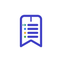
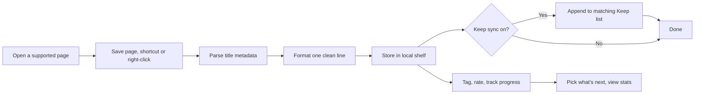

# KeepShelf

<p align="center">
  
</p>

<p align="center">
  <strong>Save movies, series, anime, books and links to a personal shelf in one click.<br>
  Rate them, tag them, track your progress, get reminded when something comes out, and optionally mirror everything to Google Keep.</strong>
</p>

<p align="center">
  <a href="manifest.json"></a>
  <a href="manifest.json"></a>
  <a href="LICENSE"></a>
  <a href="package.json"></a>
  
  
</p>

<p align="center">
  <a href="../../releases/latest"></a>
</p>

<p align="center">
  <a href="#quick-start">Quick start</a> ·
  <a href="#features">Features</a> ·
  <a href="#supported-sources">Sources</a> ·
  <a href="#organise-and-track-your-shelf">Organise</a> ·
  <a href="#google-keep-sync">Keep sync</a> ·
  <a href="#installation">Install</a> ·
  <a href="#faq">FAQ</a>
</p>

---

## Screenshots

<p align="center">
  
  
  
</p>
<p align="center">
  
  
  
</p>
<p align="center">
  
  
  
</p>


---

## At a glance

| | |
|---|---|
| **What it does** | Reads title metadata from supported pages and saves a clean, formatted entry to your local shelf with one click |
| **Beyond saving** | Tags, custom lists, personal ratings and reviews, watch/read progress (down to each season), release reminders, a random "what next" picker, a stats dashboard, and Undo for deletes and merges |
| **Also works as** | A lightweight bookmark manager for tabs, links and notes |
| **Where data lives** | Locally in Chrome storage on your device. Optional sync to your own Google Keep notes, optional TMDB lookups, and optional book details from Open Library with your own free token |
| **Who it is for** | Anyone keeping a watchlist, reading list, anime list or link collection without copy-pasting or tab-hoarding |
| **Setup time** | About 2 minutes to load the extension, about 5 more to link Keep notes if you want sync |
| **Cost** | Free and open source. No accounts, no API keys, no cloud backend |

---

## Table of contents

- [Why KeepShelf exists](#why-keepshelf-exists)
- [Quick start](#quick-start)
- [How it works](#how-it-works)
- [Features](#features)
- [Organise and track your shelf](#organise-and-track-your-shelf)
- [TMDB info](#tmdb-info)
- [Episode ratings](#episode-ratings)
- [Search TMDB from the search box](#search-tmdb-from-the-search-box)
- [Release reminders](#release-reminders)
- [Book info](#book-info)
- [Supported sources](#supported-sources)
- [Tabs, links and notes](#tabs-links-and-notes)
- [Output format](#output-format)
- [Installation](#installation)
- [Usage guide](#usage-guide)
- [Google Keep sync](#google-keep-sync)
- [Backup and import](#backup-and-import)
- [Privacy and data](#privacy-and-data)
- [Permissions explained](#permissions-explained)
- [Development](#development)
- [FAQ](#faq)
- [Troubleshooting](#troubleshooting)
- [Roadmap](#roadmap)
- [Contributing](#contributing)
- [License](#license)

---

## Why KeepShelf exists

Someone sends you ten movie and book recommendations. The usual workflow:

1. Google the title
2. Copy the name, year and rating by hand
3. Switch to Google Keep or a notes app
4. Paste one formatted line
5. Repeat nine more times

That takes minutes per title. KeepShelf reduces it to **open popup, click Save page, done**.

You stay on the page you are already on. KeepShelf reads the knowledge panel or page metadata, formats one clean line, stores it locally, and (if you enable it) pushes that line into the right Google Keep checklist in the background.

Once it is on your shelf, you can rate it, tag it, track how far you are, and let KeepShelf pick what to watch tonight.

---

## Quick start

**Fastest path:** download the latest ZIP from the [Releases page](../../releases/latest), extract it, and load it unpacked in Chrome. No tools needed. See [Installation](#installation) for the steps, or to build from source.

Once the extension is loaded:

1. Pin KeepShelf to your Chrome toolbar.
2. Open a movie on IMDb, an anime on MyAnimeList, a book on Goodreads, or search for anything on Google.
3. Click the **KeepShelf icon**, then **Save page**. Or press `Alt+Shift+S` without opening the popup.
4. Your item appears on the shelf immediately.

Want automatic Keep sync? Jump to [Google Keep sync](#google-keep-sync).

---

## How it works



1. **Detect:** KeepShelf runs on supported pages and reads title, year, runtime or seasons, author and ratings.
2. **Parse:** metadata comes from page JSON-LD, knowledge panels or the DOM.
3. **Save:** duplicates are detected and skipped. Near-duplicates are flagged.
4. **Sync:** if Keep sync is on, the formatted line is appended to the matching Google Keep checklist in the background.

---

## Features

### Save in one click

Click **Save page** in the popup, press `Alt+Shift+S`, or right-click a page, link or selected text and choose **Save … to KeepShelf**. The toolbar badge shows `+` when a page can be saved and `✓` when it is already on your shelf.

| Type | What gets captured |
|------|--------------------|
| **Movies** | Title, year, runtime, IMDb, Letterboxd, Rotten Tomatoes or Trakt rating |
| **Series** | Title, year, latest season count, rating |
| **Anime** | Title, year, episode count, MAL score |
| **Books** | Title, author, published year, Goodreads or BookFilter rating |
| **Tabs, links, notes** | Title and URL, or note text (see [Tabs, links and notes](#tabs-links-and-notes)) |

### Three-tab shelf

| Tab | Stores |
|-----|--------|
| **Media** | Movies, series and anime (filter by type) |
| **Books** | Books from any source |
| **Tabs** | Saved tabs, links and notes |

### Rate, tag and track

Your own ratings and reviews, tags, custom lists, watch and read progress (episode by episode, season by season), a random picker and stats. Details in [Organise and track your shelf](#organise-and-track-your-shelf).

### Search TMDB from the search box

The search box on the **Media** tab filters your shelf as you type. When what you typed isn't on it, or you want something else, tap the row under the list, **Search TMDB for "dark matter"**. The results replace the shelf: each has a poster, title, year, type, TMDB rating and a short description. Tap **Add** and it goes onto your shelf as **To watch**, with its poster, genres and episode counts already filled in, and you get an **Undo** for a few seconds. **My shelf** takes you back.

- Anything already on your shelf says **On shelf** instead of Add, so you can't add it twice.
- Descriptions are cut to two lines; rest the pointer on a result to read all of it.
- Results are movies, series and anime. TMDB doesn't label anime, so KeepShelf files a Japanese animated title as **Anime** and everything else as a movie or a series. If one is wrong, change its type in **Edit**.
- It needs your [TMDB token](#tmdb-info). Without one the row tells you to add it in Settings.
- **Settings > TMDB > Search TMDB from the search box** chooses how it behaves:
  - **Show a "Search TMDB" row** (the default): nothing is sent until you tap the row.
  - **Also search by itself when nothing matches**: if at least three letters match nothing on your shelf, KeepShelf searches TMDB a moment after you stop typing. Words are only sent in this case.
  - **Off**: the row never appears and nothing is sent.
- The Books and Tabs tabs don't search online.

### Trailer

Press **Trailer** on the card of any title that has TMDB info and its trailer opens on YouTube in a new tab. KeepShelf picks a trailer over a teaser over other clips, an official one over a fan upload, and the newest. It looks for English trailers first, then in the common film languages, so a Hindi or Korean film finds its own. If TMDB has no usable video the button says **No trailer on TMDB** for a moment. Nothing is embedded or stored: it asks TMDB when you press the button, and only a YouTube address that passed a check is ever opened. It needs your TMDB token.

### More like this

On the card of any title that has TMDB info, **More like this** shows what TMDB recommends for it, in the same list as a search. TMDB's recommendations come from what viewers watch, not from franchises, so the title's own sequels, remakes and the other films in its TMDB collection are listed first under **Same franchise** (oldest first), and the recommendations follow under **You might also like**. Sequels are found by name ("Drishyam 2", "Dune: Part Two", a remake with the same title) and by TMDB's collection data; a sequel with a completely different name and no collection on TMDB won't be in either list. Each result has a poster, rating and description, an **Add** button, or **On shelf** if you already have it. **My shelf** takes you back, and typing in the search box or changing tab closes it too. It works even if the TMDB search row is switched off, because you asked for it, and it needs your TMDB token. Nothing is saved with the title: the recommendations are fetched when you ask.

## Episode ratings

On the card of a series or anime that has TMDB info, a **grid icon** sits at the top right. Tap it and the same card becomes a grid of episode ratings: **seasons across, episodes down**, each cell coloured by its rating (a strip under the headline numbers shows the colours from Garbage to Absolute cinema), with the average of each season pinned along the bottom. The top shows the **average**, the **best** and the **lowest** episode; tap Best or Lowest to jump to it in the grid. Use the back arrow, or **Esc**, to return to the card.

- The ratings are **TMDB's own**, so they can differ from IMDb's. A very new episode may show **–** because nobody has rated it yet.
- Only the grid scrolls, the card around it stays put. Season and episode labels stay in place while the cells move, so a 15-season show such as Supernatural stays readable. Hover over a cell (or tap it on a touch screen, or tab to it) and a small tip beside it shows the episode title, rating, votes and air date.
- **Mark episodes watched from the grid.** Tap an episode and the strip above the grid offers **Watched up to here**: every earlier episode and season is marked watched, and the ones you've watched fade back with a tick, so what is left stands out. Tap an episode you've already watched and it offers **Not watched from here** instead. Each change has an **Undo** for a few seconds, marking the last episode finishes the show (and offers the rating box), and the card you go back to shows the new progress. It needs the show's season counts from TMDB (fetch info for your shelf); without them the grid is read-only.
- It needs your [TMDB token](#tmdb-info) and a TMDB match for the title. Movies, books and titles with no match don't show the icon.
- A show costs one request to TMDB (a few more for very long ones). The result is kept in memory for the browser session, for up to a day, then fetched again. It is never saved with your shelf or in a backup.

## Release reminders

Turn on reminders and get a notification when a series you haven't finished has a new episode, a series you've finished is coming back with a new season, or a movie on your shelf comes out, today or tomorrow. See [Release reminders](#release-reminders).

### Undo

Deleted something by mistake, or merged the wrong duplicates? An **Undo** button appears for 8 seconds and puts everything back exactly as it was. See [Undo](#undo-for-deletes-and-merges).

### Find things fast

- **Search** across title, author, genre, URL, notes, tags, lists and your reviews
- **Filter** by type, status, tag and list. KeepShelf opens with watched items hidden (see [Default view](#default-view-hide-what-youve-watched))
- **Sort** by newest, oldest, title, year, source rating or your own rating
- **Poster and cover thumbnails** next to each item. **Tap a row** to open a card with everything about it: the full description, your status, rating, tags and review, a **Watch** button for each [watch site](#watch-sites) you added, and **Open page** to jump back to where you saved it. Only the tick box selects a row. Hovering a row still shows a short preview

### Duplicate protection

- Saving the same title, URL or note twice shows "Already saved" and skips it, locally and in Keep.
- Near-matches such as "The Office (US)" and "Office" are flagged when you save, and a **Duplicates** panel in Settings lets you review and merge them.

### Genres, ratings and info from TMDB

Add a free TMDB token and new movies, series and anime are enriched automatically with genres, TMDB rating, age rating, overview and poster. See [TMDB info](#tmdb-info).

### Book details from Open Library

Turn on book info and your books get page counts, genres, covers, descriptions and a community rating, with no account or key. See [Book info](#book-info).

### Mirror to Google Keep

Optionally append every save to your own Google Keep checklists. No Google Cloud project or OAuth app. See [Google Keep sync](#google-keep-sync).

### Backup, import and export

Export your whole shelf as JSON (optionally with your settings), import a KeepShelf backup, or bring in a Letterboxd or Goodreads export. You can also export for Letterboxd or Trakt. See [Backup and import](#backup-and-import).

### Clipboard export

The **copy icon** next to the search box copies every item the list is showing as plain text, one line each. Tick some rows first and it copies only those (hover it to see "Copy 3 selected").

### Privacy first

Everything stays on your device unless you turn on an optional feature: Keep sync, TMDB lookups, or book info from Open Library. No analytics and no third-party data collection.

---

## Organise and track your shelf

All of this is stored on your shelf only. Your Keep lists are never changed by it.

### Status and progress

Every movie, series, anime and book has a status. Each row also shows a small **Movie, Series, Anime or Book** badge on the Media tab, so you can tell them apart at a glance.

| Status | Meaning |
|--------|---------|
| **To watch / To read** | Planned (the default) |
| **In progress** | Started but not finished |
| **Watched / Read** | Finished. The ✓ button on each row still toggles this |
| **Dropped** | Gave up on it |

For series, anime and books you can also record progress, such as episodes done out of total, or pages read out of total. Movies have no progress fields. The total episode count fills in automatically from TMDB or the source page, and you can still override it. Rows show a compact line like `In progress · ep. 3/12 · ★ 8/10`.

### Default view: hide what you've watched

KeepShelf opens on **Not watched**: what is still to watch or in progress. Watched and dropped items stay out of the way, so the list is what you actually want to pick from. (On Books it is "Not read", on Tabs it is "To do".)

- **Searching looks at everything.** While there is something in the search box, the status filter steps aside (the status box shows **All** and is greyed out), so a title is found whether it is to watch, in progress, watched or dropped. Clear the box and your status choice, or the default view, is back.
- To see everything for a while, open the filter button next to the search box and pick **All** in the status list. The next time you open KeepShelf it is back to the default view.
- The status dropdown has **All**, **Not watched**, **To watch**, **In progress**, **Watched** and **Dropped**, so you can look at any one of them.
- In **Settings > Shelf & views**, **Start on** chooses between **My default view** and **Where I left off** (the tab, type, status and list you last used). **Default view** chooses **Hide watched and dropped** or **Show everything**. Search and tag filters always start empty.

### Mark the next episode watched

Series and anime that aren't finished have a **+1 episode** button on the row (it shows when you hover, like the other row buttons) and a small black **+ S2 E6** pill among the chips on the item's card (**+ ep. 120** for a show without seasons). One tap marks that episode watched and moves on to the next.

- It starts a show you hadn't started, and picks up one you had dropped.
- The last episode finishes the show and, if the rating prompt is on, offers the rating box.
- A message at the bottom says what changed, with **Undo** for a few seconds.
- A [watch site](#watch-sites) address that includes an episode follows your progress, so its button always opens the next episode.

### Season-by-season progress

For series and anime that have [TMDB info](#tmdb-info), the Edit dialog shows **one box per season** instead of a single number, with each season's episode count as a hint (`/10`).

- Type how many episodes you have watched in each season, or click the **✓** next to a season to mark all of it watched.
- A **Next up: S2 E6** line under the boxes tells you where to continue.
- The **status follows along**: some episodes watched sets *In progress*, every episode sets *Watched*, and lowering the count of a finished show puts it back to *In progress*. You can still change the status yourself.
- Rows show where you are, such as `In progress · S2 E3 (13/24)`.
- The overall count is always the sum of the seasons, so sorting, the random picker, backups and Keep lines work as before. A season can't be set higher than its episode count.

If you were already tracking a show with a single number, opening it spreads that number across the seasons for you. Nothing changes until you edit a season box. Shows without TMDB season data keep the single **Episodes done** field. Shows you enriched before this feature get their season counts filled in automatically the next time the popup or browser starts.

### Undo for deletes and merges

After you **delete** items or **merge duplicates**, the message at the top (or in Settings, for merges) has an **Undo** button for 8 seconds. Click it and the items come back with their original order, tags, ratings, reviews and progress. For a merge, the kept item also returns to how it was before.

- Undo works only while the popup stays open. Closing it ends the 8 seconds.
- **Delete everything** (in **Settings > Backup & import**) still asks for confirmation first and can't be undone, so export a backup before using it.

### Personal rating and review

Rate anything from 1 to 10 and write a short review. Your rating is separate from the source rating (IMDb, MAL and so on), so both stay visible. Sort by **My rating** to see your favourites first. Hover the summary line on a row to read your review.

### Tags and custom lists

- **Tags** are free-form and comma separated, such as `weekend, rewatch`. They are lowercased and de-duplicated. **Genres work as tags automatically** (pick one in the tag filter, or search for it), so you only type the personal ones. Rows show up to three genres as plain text, and chips are kept for the tags you type. Click a tag chip on any row to filter by it.
- **Lists** group items under a name of your choice, such as "Weekend watch" or "Book club". Use the **List** dropdown to focus on one.

The tag and list dropdowns appear only when the current tab has any.

To set any of this, open an item's **Edit** dialog and use the **Your shelf** section.

### Pick something for me

Can't decide? Click the **dice** button in the toolbar. KeepShelf suggests one item from whatever you are currently looking at (tab, type, tag, list and search all apply).

- It picks from your **planned** items. If you have none, it suggests something already **in progress**. Finished and dropped items are never suggested.
- **Pick another** draws again without repeating the last suggestion.
- **Start watching / Start reading** moves it to *In progress*, and **Open page** jumps to it.

**Filters on the suggestion.** The small **filter** button at the top right of the card opens three choices: **Type** (movies, series or anime), **Length** (under 90 minutes, 2 hours or 2½ hours) and **Genre** (the genres on your shelf). Changing one keeps the suggestion if it still fits, and picks a new one if it doesn't. A badge on the button shows how many are on.

- **Length** means a movie that fits. A series or anime is judged by one episode, so it fits unless its episodes are longer than that. A movie with no known length is never promised to fit.
- If nothing matches, the card says **Nothing matches** and keeps the filters in reach; **Clear** (shown while any filter is on) removes them all and keeps the suggestion you have.
- Your filters are remembered, and they stack on top of what you are looking at (tab, type, tag, list and search).

Tip: you can still filter to a tag like `weekend` first to narrow the pool.

### Duplicates

Open **Settings, then Duplicates, then Find duplicates**. KeepShelf groups titles that look like the same thing saved twice. It matches on normalised titles (ignoring case, accents, punctuation, a leading "The" and bracketed qualifiers), and it will not match items with years more than a year apart or books by different authors.

For each group, choose the entry to keep and click **Keep selected, merge rest**. Tags, rating, review, list and progress from the others are merged into it, and the most advanced status wins. Click **Not duplicates** to dismiss a group.

### Stats dashboard

Click the **chart icon** in the popup header to see:

- Totals for saved, finished and in-progress items, plus your average rating
- **Finished per month** for the last 12 months
- The distribution of your ratings
- Breakdowns by **type**, **genre** and **tag**

Hover or focus any bar for exact numbers, or expand **View as table**.

---

## TMDB info

[TMDB](https://www.themoviedb.org) is optional and off until you add a token.

**Set it up**
1. Create a free account at themoviedb.org and request an API key under **Settings, API**.
2. Copy the **API Read Access Token** (a long string starting with `eyJ`). The 32-character API key also works.
3. In KeepShelf, open **Settings > TMDB**, paste it, click **Save**, then **Test**.
4. Click **Fetch info for my shelf** to fill in what you already saved.

**What you get** for movies, series and anime, filled in for you:
- **Genres**, shown as a short line on each row and usable as tags in the filter (so you can filter by `drama` without typing anything). They also feed your [stats](#stats-dashboard).
- **Runtime** for movies, **seasons** for series and **episode count** for anime, used in the row and in copied or Keep lines when the source page didn't give one.
- **Total episodes** for series and anime, so progress shows as `ep. 3/62` without you entering the total, plus **episodes per season** for [season-by-season progress](#season-by-season-progress).
- **Next air dates** for series and **release dates** for movies, used by [release reminders](#release-reminders).
- TMDB rating, age rating (US), overview, and a poster when the source page had none.
- An **[episode ratings grid](#episode-ratings)** for series and anime, opened from the grid icon on the item's card.
- **[Search TMDB](#search-tmdb-from-the-search-box)** from the shelf's search box, **[More like this](#more-like-this)** and a **[Trailer](#trailer)** button on a card, to find and add titles you haven't saved yet.

Anything the page itself provided wins over TMDB, and anything you type wins over both. Books are not covered by TMDB, which only has films and TV. Books have their own option, see [Book info](#book-info).

**How matching works**
- Pages from IMDb (and any item whose source URL has an IMDb id) match exactly.
- Everything else is searched by title and year. KeepShelf only accepts a close title match and would rather show no match than a wrong one.
- If a match is wrong, open the item's **Edit** dialog and click **Wrong match? Remove**. It won't be looked up again unless you click **Fetch info**.

**Good to know**
- Titles are sent to TMDB to look them up. Nothing else is, and your token never leaves your browser except in requests to TMDB. When you search from the search box, the words you typed are sent too, and only when you ask (see [Search TMDB](#search-tmdb-from-the-search-box)).
- TMDB's terms limit how long its data may be kept, so KeepShelf refreshes it after about 5 months and drops it after 6. Backups follow the same rule.
- The IMDb, Letterboxd and other ratings still come from the page you saved. TMDB's rating is shown separately as `TMDB 8.4`.
- [Episode ratings](#episode-ratings) are fetched only when you open the grid, kept in memory for that browser session and never saved with your shelf or in backups.

*This product uses TMDB and the TMDB APIs but is not endorsed, certified, or otherwise approved by TMDB.*

---

## Release reminders

Get a desktop notification when something on your shelf is about to come out. It is optional and **off until you turn it on**, and it uses your [TMDB](#tmdb-info) token.

**Set it up**
1. Add your TMDB token first (see [TMDB info](#tmdb-info)). The switch stays disabled until a token is saved.
2. Open **Settings > TMDB** and switch on **Release reminders**.
3. Click **Check for releases now** to try it. Chrome may also need notifications allowed for it in your operating system.

**What you get**
- A notification when a **series** you haven't finished has an episode airing **today or tomorrow**, naming the season and episode, such as `Severance: S2 E5 tomorrow`.
- A notification when a **movie** on your shelf is released today or tomorrow, such as `Dune: out today`.
- Several releases at once are grouped into one notification. Clicking it opens KeepShelf.
- **New seasons of shows you've finished** are announced too, as `Severance: new season, S3 E1 tomorrow`, and listed on **Coming up** with "New season" under the title. This is its own switch under Release reminders (**New seasons of shows I've finished**, on by default). It only counts a season the show didn't have when you finished it, so the last episodes of a season you already watched are not announced as new.
- Other items you have marked **Watched**, and anything **Dropped**, are never announced, and each release is announced **only once**. A new episode of the same show gets its own reminder.

**How it works**
- To tell a new season from an old one, KeepShelf remembers how many seasons a series had when you finished it. A season that is only announced doesn't count as one you finished: if its premiere is already scheduled when you mark the show finished (or when an older finished show is first checked), the seasons before that premiere are the ones you finished, so that season is announced when it comes. A season that is already airing counts as seen. Finish a show again later and the number is updated.
- KeepShelf checks a few times a day (every 6 hours, so a computer that was asleep still catches up). It reads the dates it already has and refreshes dates that may have moved: airing series whose next date has passed or is unknown, and movies not yet released. Each item is looked up at most about once a week, and a check makes at most 25 requests, with what is airing now first and finished shows after it. Finished shows that have ended or been cancelled are never looked up.
- If TMDB can't be reached, reminders still work from the dates already saved.
- Only titles are sent to TMDB, as with the rest of TMDB info. Nothing else leaves your browser.

**Good to know**
- It can only remind you about things TMDB knows the date of. Between seasons a series has no next date, so there is nothing to announce until TMDB lists one.
- Turn the switch off at any time and the background checks stop.

### Coming up

The **calendar** button in the header opens **Coming up**: what is airing or releasing in the **next 2 weeks** (or **1 month** or **3 months**, picked with the buttons at the top and remembered) for titles you haven't finished, grouped by day (**Today**, **Tomorrow**, then the date). Each row shows the poster, the title, and **S2 E6** for an episode or **Release** for a movie. Tap a row to open that title's card.

- It works without turning on reminders, but it needs your [TMDB token](#tmdb-info) and fetched info, because the dates come from TMDB.
- Opening it quietly looks up new dates for titles whose saved dates may be out of date (the same rule reminders use, so each title is looked up about once a week at most), then redraws. If TMDB can't be reached it shows the dates already saved. It never sends a notification.
- **Watched** and **Dropped** titles are left out, and so is anything TMDB has no date for. Between seasons a series has no next date.
- **Streaming dates for movies.** For a movie, TMDB also knows when it reaches streaming and online stores (its "digital" release). A movie that is out in cinemas but not yet on streaming gets its own **Streaming** row on that day, and a movie still to come out says **Streaming 9 Dec** under its title. A film released straight to streaming has a single **Streaming** row. KeepShelf uses your browser's country first (for example India for `en-IN`) and falls back to the US, so the date is the one for where you are when TMDB has it; hover the pill to see which country. TMDB often has no streaming date until it is close, and it does not say which service.
- **Movies and streaming** lists every movie you haven't watched that is unreleased or came out in the last five months, with where it stands: **On streaming** (since a date), a later streaming date, **No date** (TMDB has none yet) or **Not checked** (tap Check for new dates). It opens by itself when no streaming date is in the list above, so you can see why.
- **No date yet** lists the shows you follow that TMDB says are still airing but gives no next episode date for (or whose saved date has passed). A long-running show such as a weekly anime often has none until the episode is close, so it can be missing from the dated list for that reason. The list opens by itself when it is all there is.
- **Check for new dates** looks up dates right now for those shows, ignoring the once-a-week limit, and says how many still have none.
- Movies saved before streaming dates existed pick them up the next time their dates are checked (about once a week), or straight away with **Check for new dates**.

---

## Book info

[Open Library](https://openlibrary.org) is the free book catalogue behind this. It is optional and **off until you turn it on**, and it needs **no account and no key**.

**Set it up**
1. Open **Settings, Book info** and switch on **Fetch book details from Open Library**.
2. Click **Fetch info for my books** to fill in the ones you already saved. New books are looked up automatically as you save them.

**What you get** for books, filled in for you:
- **Page count**, and the **total pages** for progress fills in automatically, so it reads `p. 212/528` without typing the total.
- **Genres** (from Open Library's subjects), shown as a short line and usable as tags in the filter.
- A **cover**, a **description** (shown when you rest the pointer on a row, and in the random picker), and a **community rating** shown as `OL 4.1`.

Anything the page gave you wins over Open Library, and anything you type wins over both. Your saved publication year is never overwritten, because Open Library reports when a book was *first* published.

**How matching works**
- Books are searched by **title and author**. A book is only matched if the author agrees and the title is a close match, so KeepShelf shows nothing rather than the wrong book. Items with no author are only matched when the title is unambiguous.
- If a match is wrong, open the book's **Edit** dialog and click **Wrong match? Remove**. It won't be looked up again unless you click **Fetch info**.
- Some books simply aren't in the catalogue (a manga volume, for example), and they stay as they are.

**Good to know**
- Book titles and authors are sent to `openlibrary.org` to look them up, and nothing else is. That is why it is off by default.
- Open Library asks clients to stay at about one request per second, and each book needs two, so KeepShelf paces itself. A big shelf takes a little while, and a short batch of four books takes around ten seconds.
- The community ratings come from a smaller group than Goodreads, so they are labelled `OL` and shown beside the rating from the page you saved from.
- Subjects are crowdsourced, so KeepShelf keeps the first few, tidies them up and drops catalogue labels, but an odd one can still slip through. Edit the tags if one bothers you.

*Book data from Open Library (openlibrary.org).*

---

## Supported sources

| Source | Page type | Captures |
|--------|-----------|----------|
| [Google Search](https://www.google.com) | Knowledge panel on search results | Movies, series, anime, books |
| [IMDb](https://www.imdb.com) | Title pages (`/title/tt…`) | Movies and TV with IMDb rating |
| [Letterboxd](https://letterboxd.com) | Film pages (`/film/…`) | Title, year, runtime, LB rating |
| [MyAnimeList](https://myanimelist.net) | Anime pages (`/anime/…`) | Title, year, episode count, MAL score |
| [Goodreads](https://www.goodreads.com) | Book pages (`/book/show/…`) | Title, author, year, GR rating |
| [BookFilter](https://www.book-filter.com) | Book pages (`/books/…`) | Title, author, year, BF rating |
| [Series Graph](https://seriesgraph.com) | Show pages (`/show/…`) | Series with season count and IMDb rating |
| [Rotten Tomatoes](https://www.rottentomatoes.com) | Movie and TV pages (`/m/…`, `/tv/…`) | Title, year, runtime or seasons, Tomatometer |
| [Trakt](https://app.trakt.tv) | Movie and show pages (`/movies/…`, `/shows/…`) | Title, year, runtime, Trakt rating |

### Watch sites

KeepShelf can add a **play button** to each title that opens its exact page on a site where you watch. It is optional and **nothing is included by default**: you add your own sites in **Settings > Watch sites**. KeepShelf never visits or reads those sites. It only builds the link.

To add one:

1. Open any title's page on the site and copy the address.
2. In **Watch sites**, paste it and pick which title on your shelf it is for.
3. Optionally paste a page for the other kind (a series if the first was a movie, or the other way round), because many sites use a different address for each. Without it, only the kind you gave gets a button.
4. Click **Add this site**. KeepShelf works out what the address contains (a TMDB id, an IMDb id, or the title and year) and uses that for every other title.

Notes:
- Sites that use a TMDB id need your [TMDB token](#tmdb-info) and fetched info for the title. Sites that use an IMDb id work for titles saved from IMDb even without a token.
- If you only gave one kind of page, the site's row says "Movies only so far" (or "Series only") and has an **Add a series page** (or movie) button, so you can add the other kind later without starting over.
- Some sites add random letters to their title addresses, and those can't be worked out. For those, paste the address of a **search results page** for one title instead (search for a title with two or more words, and pick that title; for a title like `One Piece: Wan pîsu`, search for the part before the colon, `One Piece`). Every title then gets a **Search on …** button that opens that site's search for it. That opens a search, not the exact page.
- Each site row has **Show on** tick boxes (Movies, Series, Anime), so a site only adds its button to the kinds of title it is for. A site added with an anime as the example starts as anime only; anything else starts with all three. Change it any time.
- If the address you paste is an **episode page** (such as `…/one-piece-episode-1180`), the button opens the **next episode you haven't watched**, taken from your episode progress, or episode 1 if you haven't started. Addresses that also name a season (`season=1&episode=1`) keep the numbers as you pasted them. A site that spells a title differently from how it is saved here may not have that page.
- If a site changes its address style, remove it and add it again.
- Up to ten sites. Each has an on/off switch, so you can keep a long list and switch off the ones you don't want right now, without removing them. If more than two sites apply to a title, its row shows one button that opens the title's card, which lists them all.
- Everything is stored only in your browser.

### Tips for best results

**Google Search**
- For anime, include the word `anime` in your query so the panel is classified correctly.
- If a book save is missing the author, scroll the knowledge panel down to load more details, then save again.

**IMDb, Letterboxd, MAL, Goodreads**
- Wait for the full page to load before saving.
- Use the canonical title page URL, not a list, review or profile URL.

---

## Tabs, links and notes

**Books and Tabs are optional.** If you only keep movies, series and anime, switch them off in **Settings > Shelf & views** (under **Tabs on the shelf**). The tab disappears, and with both off the whole tab bar goes, so the list gets more room. Nothing is deleted: your books, saved pages, links and notes stay exactly as they are, and are all back the moment you switch the tab on again. Backups still include them, and a book you save while Books is off is kept (the message says so).

The **Tabs** shelf is a lightweight bookmark manager. Switch to the **Tabs** tab in the popup.

- **Save tab** (the button at the top) bookmarks the page you are on, with its title and URL. It works on any website.
- **Paste a URL** into the input box and click **Save** to store it as a link.
- **Type any other text** and click **Save** to store it as a note.
- **Click a saved tab or link** to reopen it in a new tab.
- Tabs, links and notes can be tagged and put in lists like everything else.

Anything not on the supported-sources list can still be saved this way.

---

## Output format

Every saved item becomes one line. These are the formats KeepShelf produces, and what the copy icon and Keep sync use:

```
The Dark Knight (2008) | 2h 32m | IMDb 9.0
Inception (2010) | 2h 28m | LB 4.23
Dark (2017) | S03 | IMDb 8.7
One Piece (1999) | MAL 8.73 (A)
Death Note (2006) | 37 eps | MAL 8.62 (A)
The Kite Runner (Khaled Hosseini) | 2003 | GR 4.36
A Game of Thrones (George R. R. Martin) | 1996
GitHub | https://github.com
```

Ratings are labelled by source: `IMDb`, `LB` (Letterboxd), `MAL` (MyAnimeList), `GR` (Goodreads), `BF` (BookFilter), `RT 86%` (Rotten Tomatoes) and `Trakt`. Anime entries end with `(A)`.

Your own tags, rating, status and progress are not part of the line, so Keep and clipboard output stay clean.

---

## Installation

### Option A: Download a release (recommended)

1. Go to the [**Releases page**](../../releases/latest).
2. Download `KeepShelf-vX.X.X.zip` from the Assets section.
3. Extract it to a permanent folder (do not delete it after loading).
4. Open `chrome://extensions` and enable **Developer mode** (top right).
5. Click **Load unpacked** and select the extracted folder.
6. Pin KeepShelf to your toolbar.

No Node.js, Git or terminal required.

### Option B: Build from source

**Requirements:** Chrome or another Chromium browser (Edge, Brave, Arc, Vivaldi), [Node.js](https://nodejs.org/) 18 or newer, and [Git](https://git-scm.com/).

```bash
git clone https://github.com/thefznkhan/KeepShelf.git
cd KeepShelf
npm install
npm run build
```

Then load the cloned folder (the one containing `manifest.json`) with **Load unpacked** at `chrome://extensions`.

The extension icons are already committed. You only need `node scripts/generate-icons.mjs` (requires Python and Pillow) if you change `icons/icon.png`.

**Updating after `git pull`:**

```bash
npm install     # only if dependencies changed
npm run build
```

Then click **Reload** on the KeepShelf card at `chrome://extensions`.

---

## Usage guide

### Save a title

1. Open a supported page.
2. Click the KeepShelf icon, then **Save page** (or **Save book** on the Books tab). Or use `Alt+Shift+S`, or right-click the page.
3. The item appears on your shelf.

### Rate, tag and track it

1. Click the **pencil** on a row to open the Edit dialog.
2. In **Your shelf**, set the status, your rating, progress, tags, list and review.
3. Click **Save**. The row updates with a summary line and tag chips.

### Decide what's next

1. Optionally narrow the view with a type, tag or list.
2. Click the **dice** button, then **Start watching** or **Pick another**.

### Track a series season by season

1. Make sure the series has TMDB info (see [TMDB info](#tmdb-info)).
2. Click the **pencil** on its row. Under **Your shelf**, type the episodes watched in each season, or click **✓** to finish a season.
3. Click **Save**. The row shows where you are, such as `S2 E3 (13/24)`.

### Undo a delete or merge

1. Right after deleting or merging, click **Undo** in the message (you have 8 seconds).

### Get release reminders

1. Save your TMDB token, then switch on **Release reminders** under **Settings > TMDB**.
2. Click **Check for releases now** to see it work.

### Save a tab or bookmark

1. Switch to the **Tabs** tab.
2. Click **Save tab** at the top, or paste a URL or note and click **Save**.

### Manage your shelf

1. Use the filter chips, status, tag and list dropdowns, search box and sort menu to narrow the view.
2. Tick the box on each item (tapping a row opens its card instead), then use the copy icon, the cloud icon to sync them to Keep, or the trash icon to delete them (you can **Undo** for a few seconds). The sync button only appears when the Keep list for the tab you are on (Media, Books or Tabs) is switched on in Settings, so it stays out of the way if you don't use Keep.
3. **Delete everything**, at the bottom of **Settings > Backup & import**, empties your shelf. Keep notes are never affected.

### Configure Keep sync

1. Open **Settings** (gear icon).
2. Paste the full Keep note URL for each section (Media, Books, Tabs).
3. Turn on the toggle for each section you want synced, and click **Save**.
4. Click **Test** while signed into Keep in Chrome.

---

## Google Keep sync

KeepShelf can append each saved line into Google Keep **checklist notes**. It works with a personal Google account and needs no OAuth app or Google Cloud project.

### Step 1: Create Keep list notes

In [Google Keep](https://keep.google.com), create checklist notes (enable **Show checkboxes**):

| Note | Used for |
|------|----------|
| **Media watchlist** | Movies, series and anime |
| **Books list** | Books from any source |
| **Tabs list** | Saved tabs, links and notes |

You can paste the same URL into several sections if you prefer one list.

### Step 2: Copy the full note URL

Open each note and copy the complete URL from the address bar:

```
https://keep.google.com/#LIST/your-long-list-id-here
```

The list ID is usually 40+ characters. If Settings shows **URL looks incomplete**, paste the full URL again from the address bar.

### Step 3: Link them in KeepShelf

Open **Settings**, paste the URL into the matching field, turn on the toggle, click **Save**, then **Test**. A test line is added to the note.

### How sync works

| Step | Behaviour |
|------|-----------|
| Local save | The item is stored in KeepShelf first, always |
| Routing | Movies, series and anime go to the Media note, books to the Books note, tabs, links and notes to the Tabs note |
| Background sync | Keep opens in a hidden tab, so you stay on your current page |
| Duplicate skip | Identical lines are not added twice |
| Failure | The item stays on your shelf with a retry icon. Click it, or use **Sync selected** |
| Scope | Only the formatted line is synced. Tags, ratings, status and edits stay on your shelf |

### Why the debugger permission?

Google Keep only persists list items entered through trusted browser input. KeepShelf briefly uses Chrome's debugger API to deliver that trusted keystroke so your lines survive after the note is closed. You may see a short banner, **"KeepShelf started debugging this browser"**, which disappears when sync finishes.

---

## Backup and import

Your shelf lives only in this browser, so export a backup now and then.

- **Export backup** (Settings) downloads everything as JSON, including tags, lists, ratings, reviews, status and progress (per season too).
- **Include my settings** (on by default, next to the export button) also saves your TMDB token, Keep links, watch sites, the reminders and book-info switches, and your other preferences. **The file then contains your TMDB token, so keep it private**; turn the switch off to export only your shelf.
- **Import** accepts:
  - a **KeepShelf backup** (`.json`)
  - a **Letterboxd** export CSV (watchlist, watched, diary or ratings)
  - a **Goodreads** library export CSV
- Items already on your shelf are skipped, and imported items are not sent to Keep.
- If a backup has settings, KeepShelf asks **"Restore your settings?"** and lists what is in it. **Restore settings** replaces the ones you have now; **Skip** imports only the items. Older backups have no settings and import as before.
- Letterboxd and Goodreads imports mark watched and read items as finished.

### Export for Letterboxd and Trakt

Under **Backup & import**, **For Letterboxd** and **For Trakt** write your shelf as CSV files those services can import. Each shows exactly what went in and what was left out.

- **For Letterboxd** (films only, [letterboxd.com/import](https://letterboxd.com/import/)) downloads two files: **watched** (films you have watched, with the date you finished them, your rating as 0.5 to 5 stars, your review and your tags) and **watchlist** (films still to watch or in progress). Letterboxd has no TV, so series and anime series are left out, and films you dropped are skipped. Films are matched by their TMDB and IMDb ids when KeepShelf has them, so [fetch info for your shelf](#tmdb-info) first for the best matching.
- **For Trakt** downloads one file with films, series and anime: watched titles carry their watched date and your rating (1 to 10), and everything else goes on the watchlist. Only titles with an IMDb id saved are included, because a bare number can match the wrong title on Trakt; the rest are counted as left out (fetch info first). A series you are partway through goes on the watchlist, because a CSV can't say which episodes you have seen. Dropped titles are skipped.
- Trakt's importer is not officially documented and has changed before, so try it with the file first and check the result on Trakt. Imports can be undone from your Trakt settings.
- Nothing is sent anywhere: the files are written in your browser and saved through the normal download. Text you wrote (titles, reviews, tags) that starts with `=`, `+`, `-` or `@` gets a leading apostrophe so a spreadsheet never runs it as a formula.

### Add titles from a pasted list

Under **Backup & import**, **Add titles from a pasted list** takes lines like the ones KeepShelf's copy icon writes, or a Keep checklist:

```
Drishyam (2015) | 2h 43m | IMDb 8.2
Fargo (2014) | S05 | IMDb 8.8
86 (2021) | S01 | IMDb 8.3 (A)
```

- `S05` is a series with five seasons, `(A)` at the end marks anime, and anything else with a runtime is a movie. The year is optional, bullets and boxes are ignored, and other parts of a line (other sites' ratings, certificates) are skipped.
- A heading line such as **Watched** or **To watch** switches the lines under it, a ticked box (`[x]`, `☑`) means watched, and **These are** sets the default for lines with neither.
- A summary under the box says how many titles were found, how many are watched, how many are already on your shelf, and how many look like ones you have under another spelling (those are skipped and named). The button shows how many it will add.
- **Undo** removes exactly the titles you just added.
- If you have a [TMDB token](#tmdb-info), posters, genres and episode counts are **fetched automatically** right after the titles are added, ten at a time with progress in the message at the bottom (and Open Library details for books, when book info is on). Titles TMDB can't match are left as they are, and if TMDB is unreachable the titles are still added; **Fetch info for my shelf** finishes the rest. Without a token, a hint says how to turn this on. The same happens after importing a Letterboxd or Goodreads file.

Importing from a file picker opens Settings in a full tab, because Chrome closes the popup when a file dialog opens.

---

## Privacy and data

| Data | Where it lives |
|------|----------------|
| Saved shelf items, including tags, ratings and reviews | `chrome.storage.local` (your device only) |
| Keep settings (URLs, toggles) | `chrome.storage.local` (your device only) |
| Keep list content | Your Google Keep account (only when sync is on) |
| TMDB token and fetched TMDB info, including season counts and release dates | `chrome.storage.local` (your device only; refreshed or dropped after about 6 months) |
| Release reminder setting and which releases were already announced | `chrome.storage.local` (your device only) |
| Fetched book info (pages, genres, description, rating) | `chrome.storage.local` (your device only) |

KeepShelf has no server of its own and does not collect your data. It only talks to services you switch on: Keep sync talks to `keep.google.com` inside your signed-in browser session, TMDB lookups (including the background date checks for release reminders) send item titles (and IMDb ids) to `api.themoviedb.org` using your own token, and book info sends book titles and authors to `openlibrary.org`. Posters and covers load directly from the source site's, TMDB's or Open Library's image server, without a referrer.

Uninstalling the extension removes all local shelf data. KeepShelf only ever appends lines to your Keep notes. It never edits or deletes them.

---

## Permissions explained

| Permission | Why it is needed |
|------------|------------------|
| `storage` | Save your shelf and settings locally |
| `tabs` | Read the current tab's URL and title; find or open Keep note tabs for sync |
| `scripting` | Run the Keep append script inside your Keep tab |
| `debugger` | Send trusted text input so Keep persists list items reliably |
| `contextMenus` | Add the right-click **Save … to KeepShelf** entries |
| `alarms` | Run the release-reminder check a few times a day (only active once you turn reminders on) |
| `notifications` | Show the release-reminder notification |
| `google.com` | Parse Google Search knowledge panels |
| `imdb.com` | Parse IMDb title pages |
| `seriesgraph.com` | Parse Series Graph show pages |
| `goodreads.com` | Parse Goodreads book pages |
| `book-filter.com` | Parse BookFilter book pages |
| `myanimelist.net` | Parse MyAnimeList anime pages |
| `letterboxd.com` | Parse Letterboxd film pages |
| `rottentomatoes.com` | Parse Rotten Tomatoes movie and TV pages |
| `trakt.tv`, `app.trakt.tv` | Parse Trakt movie and show pages |
| `keep.google.com` | Append lines to your linked Keep notes |
| `api.themoviedb.org` | Look up genres, ratings and info on TMDB (only used once you add a token) |
| `openlibrary.org` | Look up book details on Open Library (only used once you turn on book info) |

---

## Development

```bash
npm install
npm run build     # compile into dist/
npm run watch     # rebuild on save
npm test          # run the test suite
npx tsc --noEmit  # type-check
```

| Area | Where |
|------|-------|
| Site parsers and formatting | `src/shared/` (`imdb.ts`, `letterboxd.ts`, `mal.ts`, `format.ts`, …) |
| Personal data rules (status, tags, ratings, progress) | `src/shared/user-data.ts` |
| Duplicates, random pick, stats (pure, unit-tested) | `src/shared/fuzzy.ts`, `random-pick.ts`, `stats.ts` |
| Season-by-season progress (pure, unit-tested) | `src/shared/seasons.ts` |
| Undo snapshots and restore | `src/shared/undo.ts`, `restoreItems` in `storage.ts` |
| Release reminders (due dates, notification text, settings) | `src/shared/reminders.ts`, `reminders-settings.ts`, with the alarm and notification wiring in `src/background/main.ts` |
| TMDB lookups and cache rules | `src/shared/tmdb.ts`, `tmdb-settings.ts` |
| Book info from Open Library (matching, rate pacing, cleaning) | `src/shared/openlibrary.ts`, `book-info-settings.ts` |
| Storage and backup import | `src/shared/storage.ts`, `import.ts` |
| Keep sync | `src/shared/keep-*.ts` |
| Background worker, shortcuts, context menus | `src/background/` |
| Popup UI and stats charts | `src/popup/` |
| Tests | `tests/*.test.mjs` |

New logic is easiest to test when it is a pure function in `src/shared/`: add its name to the `entries` list in `scripts/build-test-parser.mjs` and import it from `dist-test/` in a test.

For the full developer guide, including setup, icon generation, adding a new site parser and publishing a release, see [DEVELOPER.md](DEVELOPER.md).

---

## FAQ

**Does KeepShelf work without Google Keep?**

Yes. The local shelf is fully independent. Keep sync is optional and off by default.

**Can I use one Keep note for everything?**

Yes. Paste the same Keep URL into the Media, Books and Tabs fields.

**Do I need an account or a key for book info?**

No. Open Library needs neither. You only switch it on in Settings.

**Do I need TMDB?**

No. It is optional. Without a token KeepShelf works exactly as before.

**Do I need TMDB for release reminders?**

Yes. The dates come from TMDB, so you need a (free) token. Without one the switch stays disabled.

**Why didn't I get a reminder for a show I follow?**

Reminders only cover series you haven't finished that have TMDB info and a known next episode date, announced today or tomorrow. Between seasons TMDB often has no date yet. Also check that notifications are allowed for Chrome in your operating system.

**Can I undo a delete after closing the popup?**

No. Undo is available for 8 seconds and only while the popup stays open. For anything bigger, keep a backup.

**Do my tags, ratings and progress sync to Keep?**

No. Only the formatted line is sent to Keep. Everything personal stays on your shelf and in your backups.

**Why does Letterboxd show a different number than IMDb?**

Letterboxd uses a community score on a roughly 5-point scale (`LB 4.23`), IMDb a 10-point scale (`IMDb 8.8`). KeepShelf labels the source so you can tell them apart. Sorting by source rating normalises them to a common scale.

**How is "My rating" different from the rating on the row?**

The source rating (IMDb, MAL, …) comes from the website. **My rating** is yours, from 1 to 10, and has its own sort.

**What does "Pick something for me" choose from?**

Planned items in the current view. If none are planned it suggests something in progress. It never suggests finished or dropped items.

**Will my shelf survive an extension update?**

Yes, if you reload the extension rather than removing and reinstalling it. Removing it clears `chrome.storage.local`, so keep a backup. When you update by loading the new version from a different folder, Chrome treats it as a new extension. Export a backup (with **Include my settings** on) from the old one, import it into the new one, and choose **Restore settings**: nothing needs re-typing. Updating in place (put the new files in the same folder and click **Reload**) needs no backup at all.

**Can I move my shelf to another computer?**

Export a backup in Settings and import it on the other machine.

**Does this work on Firefox?**

KeepShelf targets Chromium Manifest V3. Firefox would need a separate port.

**Is there a Chrome Web Store listing?**

Not yet. Download the latest ZIP from the [Releases page](../../releases/latest) and load it unpacked.

**Can I save a page that is not supported?**

Yes. Use the **Tabs** shelf: **Save tab** bookmarks any URL.

**Why did my Keep line disappear after closing the note?**

Text inserted without trusted browser input is discarded by Keep. Reload the extension at `chrome://extensions` and save again so the debugger-based input runs.

---

## Troubleshooting

| Problem | What to try |
|---------|-------------|
| "Nothing detected on this page" | Check the URL is on the supported list and the page has fully loaded |
| Letterboxd or MAL save fails | Use the canonical title page (`/film/slug/` or `/anime/id/slug`), not a review or list URL |
| Keep line vanishes after closing the note | Reload the extension; trusted input via the debugger API is needed |
| "URL looks incomplete" in Settings | Paste the full `#LIST/…` URL from the address bar |
| Book saved without author (Google) | Scroll the knowledge panel to load the author, then save again |
| Keep Test fails | Sign into Google in Chrome and make sure the note is a checklist |
| "Already saved" on a first save | The same title is already on your shelf from an earlier session |
| "Saved (similar to …)" | A near-match exists. Review it under Settings, Duplicates |
| Tag or list dropdown is missing | They appear only when the current tab has tags or lists |
| Book info does nothing | Turn it on under Settings, Book info, then click **Fetch info for my books** |
| A book has "No match found yet" | Check the title and author in Edit (the author must be right), then click Fetch info |
| Wrong book info on an item | Edit, then Wrong match? Remove |
| "Open Library is limiting requests" | Wait a minute and try again. Fetching is paced, but a very large batch can still hit the limit |
| TMDB "rejected this token" | Paste the API Read Access Token from themoviedb.org/settings/api, with no spaces |
| "No match found" on TMDB | Fix the title or year in Edit, then click Fetch info |
| Wrong TMDB info on an item | Edit, then Wrong match? Remove |
| No season boxes in the Edit dialog | The show needs TMDB info. Add your token, then click **Fetch info** on the item (older shows fill in automatically on the next popup or browser start) |
| "Season 2 has 8 episodes, so 9 is too many" | A season can't be set above its episode count on TMDB. Lower the number, or clear the season boxes to use the single Episodes done field |
| Release reminders switch is disabled | Save your TMDB token first (Settings > TMDB) |
| No release notification appears | Click **Check for releases now**. If it says nothing is coming, nothing is due today or tomorrow. If it says it reminded you, allow notifications for Chrome in your operating system settings |
| Undo button disappeared | It lasts 8 seconds and only while the popup is open |
| Nothing to pick | Everything in the current view is finished or dropped; clear a filter or add items |
| Rating or progress is rejected | Ratings are whole numbers from 1 to 10, and progress cannot exceed the total |
| Extension still shows an old version | Reload at `chrome://extensions`, or restart Chrome |
| Changes missing after `git pull` | Run `npm run build`, then click Reload at `chrome://extensions` |

---

## Roadmap

Ideas under consideration, not promises:

- Export to CSV and Markdown
- Scheduled automatic backups
- "Where to watch" streaming availability
- More sources (AniList, StoryGraph) and games or music as new types

Have a suggestion? [Open an issue](../../issues).

---

## Contributing

Issues and pull requests are welcome. Please read [AGENTS.md](AGENTS.md) first. It has the project rules, including that versions and releases are automatic: never edit version numbers or push tags by hand.

1. Fork the repository.
2. Create a branch: `git checkout -b feature/my-change`.
3. Make your changes and add tests for new parser or shared logic.
4. Run `npm test` and `npx tsc --noEmit` to confirm nothing regressed.
5. Open a pull request describing what changed and why.

For new site parsers, include at least one saved HTML fixture and a matching test file.

---

## License

[MIT](LICENSE). Free to use, modify and distribute.
